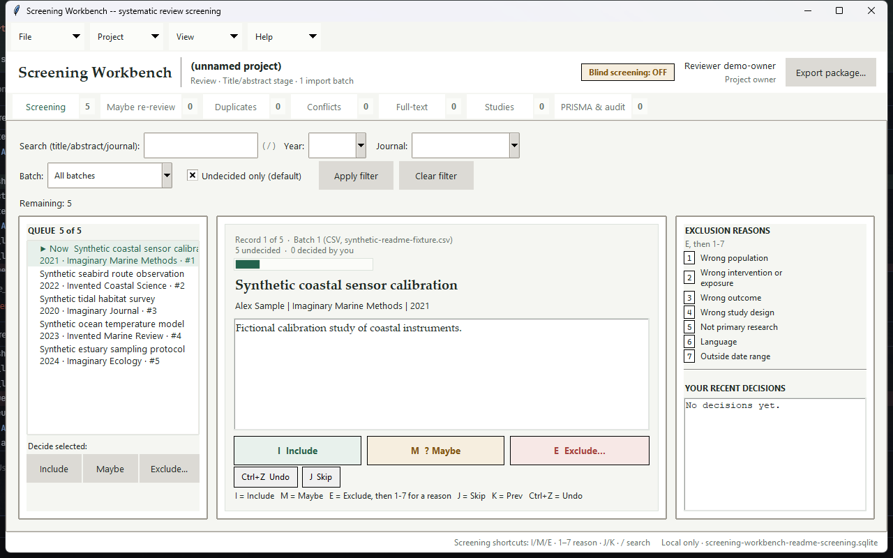
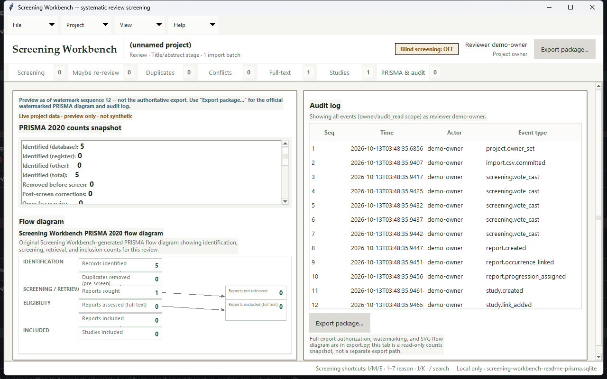

# Screening Workbench

**Free, local-first systematic-review screening.**

Screening Workbench is a free, local-first workbench for systematic-review title/abstract and full-text screening. It has no account, cloud sync, or telemetry. Records stay in the local project unless you explicitly export them; reviewer packets contain record data and must be handled as sensitive files.

## Who it's for

The individual researcher, grad student, or small lab. Screening Workbench runs on your own computer against a local SQLite project file and attachment folder: import references, screen them blinded or unblinded with a second reviewer, resolve conflicts, and export an auditable PRISMA package. The current application has no per-seat or per-review limit.

## Screenshots

**Screening queue** — keyboard-first include/maybe/exclude (`I` / `M` / `E`), search and year/journal/batch filters, a live recent-decisions panel:



**PRISMA 2020 flow diagram** — generated from one immutable watermarked snapshot, rendered live in-app and in the exported SVG from the same shared data:



More screens (Duplicates, Conflicts, Full-text, Studies, Maybe re-review) are captured throughout `docs/ui-references/`.

## Install

Windows 11 x64.

**Pre-release:** no downloadable Windows package is cleared for release yet. The exact application build, bundled-component notices, SBOM, and release package still require review. Do not use an unsigned-build bypass instruction as a substitute for verifying a release.

**Run from source** (Windows 11 x64):

```powershell
git clone https://github.com/nateriera/screening-workbench.git
cd screening-workbench
# Requires Python 3.12+ (tested on CPython 3.14) with Tkinter, both
# included in the standard python.org Windows installer. No third-party
# dependencies to install.
$env:PYTHONPATH = "src"
python -m screening_workbench.app
```

The default project is `%USERPROFILE%\screening-workbench-project.sqlite`. PDF attachments are stored beside the database under `attachments\<sha256>.pdf`; copy that folder with the database when moving a project. Reviewer packet and vote files are separate exports and do not move the original database.

## 5-minute quickstart

1. Launch the app (double-click `ScreeningWorkbench.exe`, or `python -m screening_workbench.app` if running from source).
2. **File → Import CSV...** and pick a CSV with a header row (at minimum a `title` column — `authors`, `year`, `journal`, `doi`, and `abstract` are also recognized). A handful of test rows works fine for a first look.
3. Screen each record: press **I** to Include, **M** for Maybe, or **E** then a numbered reason to Exclude. The queue auto-advances to the next undecided record.
4. Click the **PRISMA & audit** tab. The counts snapshot and flow diagram update live from the same records you just screened — no separate "calculate" step. ("Preview as of watermark sequence N" just means this on-screen view isn't the frozen, audit-stamped copy yet — that's what step 5 produces.)
5. **File → Export package...** to write the official watermarked PRISMA SVG, decisions/audit/report-study-link CSVs, and a manifest to a folder of your choice.

The quickstart describes the current workflow; check the release notes and acceptance records for the exact build and verification status.

## Clean-room build

Screening Workbench is built from public, self-authored behavioral specifications only — see `docs/specs/`. No incumbent screening application's accounts, code, UI text, labels, or assets were accessed or copied during development; specs cite only public documentation (RFCs, format references, public vendor docs) with access dates, never incumbent-product behavior. Third-party licensing (the Python/Tkinter/SQLite runtime and packaging toolchain; the application itself has no third-party Python dependencies) is reviewed in `docs/license-audit.md`.

## License

MIT — see [`LICENSE`](LICENSE).

## Known import limitations

- RIS: conflicting TI/T1 (or PY/Y1) values are not flagged; the first value wins.
- PubMed XML: a malformed file is rejected whole rather than salvaging intact records.
