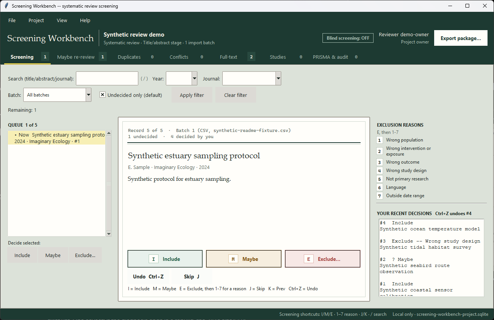
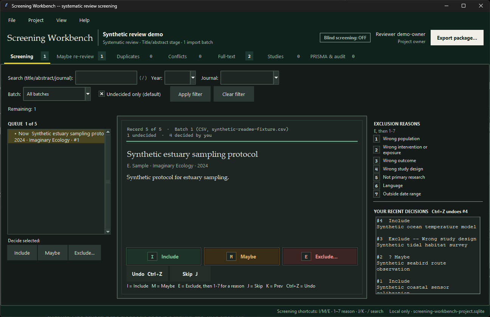
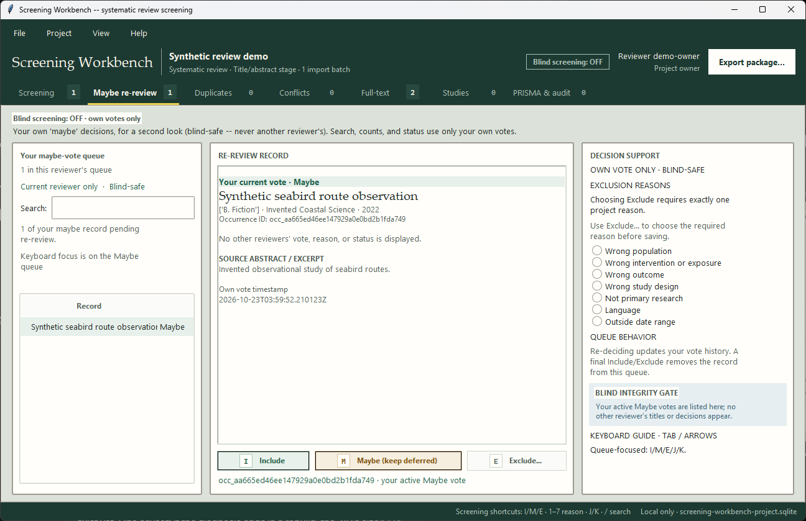
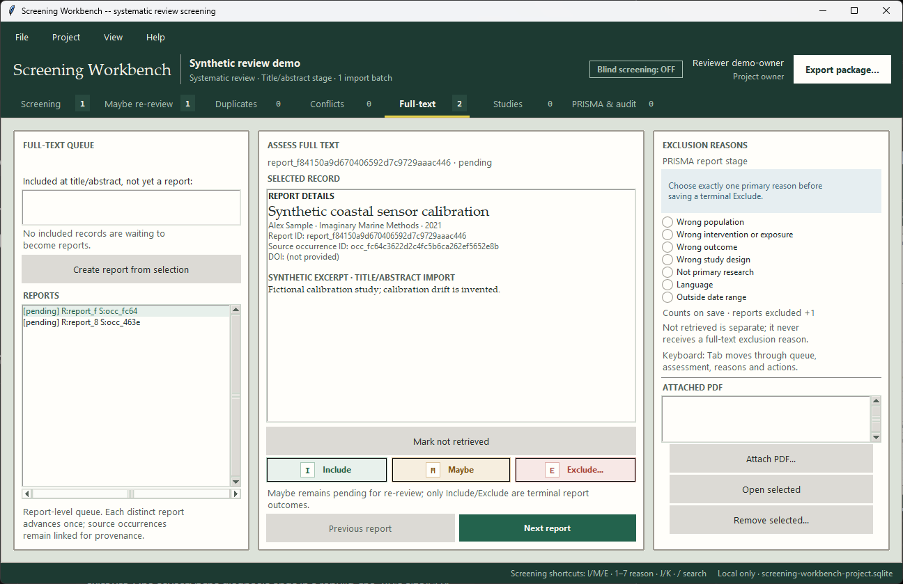
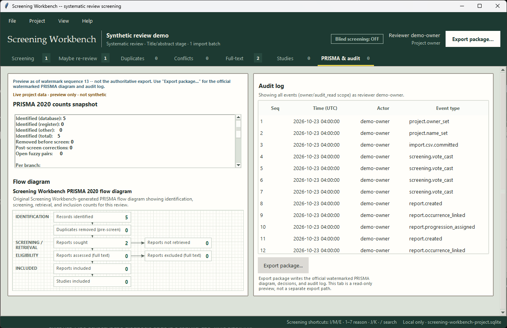

# Screening Workbench

**Free, local-first systematic-review screening.**

[](https://github.com/nateriera/screening-workbench/actions/workflows/ci.yml) [](https://github.com/nateriera/screening-workbench/releases/latest)

Screening Workbench is a free, local-first workbench for systematic-review title/abstract and full-text screening. It has no account, cloud sync, or telemetry. Records stay in the local project unless you explicitly export them; reviewer packets contain record data and must be handled as sensitive files.

## Who it's for

The individual researcher, grad student, or small lab. Screening Workbench runs on your own computer against a local SQLite project file and attachment folder: import references, screen them blinded or unblinded with a second reviewer, resolve conflicts, and export an auditable PRISMA package. The current application has no per-seat or per-review limit.

## What's new in 2.0.0

- **Card Catalogue:** drawer chrome, card-stock surfaces, highlighter accents, and a redesigned Screening record card with a call-number progress strip.
- **Bundled typefaces:** Newsreader, Atkinson Hyperlegible Next, and Atkinson Hyperlegible Mono (SIL OFL 1.1), loaded privately by the app; nothing is installed system-wide.
- **Night Stacks:** choose **View → Theme → Night** for the dark palette; the theme choice is saved between launches.
- **Decision motion:** Screening decisions show a short stamp animation. **View → Reduce motion** turns it off and also honors the Windows animation setting and `SW_REDUCE_MOTION`.
- **Keycap decisions:** Maybe re-review and Full-text use the same keycap buttons as Screening. Exclude visibly arms the reason list while its picker is open.
- **PRISMA:** the live flow preview has a graph-paper backdrop, hidden in high contrast. **File → Export package...** continues to create the official watermarked PRISMA SVG and data exports.
- **Maybe to Full-text:** Maybe decisions stay in the reviewer-owned re-review queue. After a record is re-decided Include, it can be promoted to a report for Full-text assessment.

## Screenshots

These current application captures use fictional synthetic review records. Card Catalogue is the light theme; Night Stacks is the dark theme. View > Theme applies after restarting the app; View > Reduce motion is saved and applies immediately. Maybe and Full-text both show their decision keycaps.

**Screening queue — Card Catalogue (light):**



**Screening queue — Night Stacks (dark):**



| Maybe re-review — reviewer-owned queue | Full-text — report-level assessment |
|---|---|
|  |  |

**PRISMA 2020 flow and audit preview:**



More screens (Duplicates, Conflicts, Studies, and other synthetic states) are captured throughout `docs/ui-references/`.

## Install

Windows 11 x64.

**Download v2.0.0:** [v2.0.0 release](https://github.com/nateriera/screening-workbench/releases/tag/v2.0.0) — `Screening-Workbench-2.0.0-windows-x64.zip` (17,398,639 bytes; SHA-256 `15a30f396e00f7367485181f140601899cb1b8ba5ff074ee52db64c9243f49a7`). Unzip and run `ScreeningWorkbench.exe` — no installer.

The build is not code-signed yet, so Windows SmartScreen may show "Windows protected your PC" on first launch. Choose **More info → Run anyway**, and verify your download against the SHA-256 above. Code signing is planned for a future release; the release's full verification record is `docs/release-gate-2.0.0.md`.

**Run from source** (Windows 11 x64):

```powershell
git clone https://github.com/nateriera/screening-workbench.git
cd screening-workbench
# Requires Python 3.12+ (tested on CPython 3.14) with Tkinter, both
# included in the standard python.org Windows installer. No third-party
# dependencies to install.
$env:PYTHONPATH = "src"
python -m screening_workbench.app
```

The default project is `%USERPROFILE%\screening-workbench-project.sqlite`. PDF attachments are stored beside the database under `attachments\<sha256>.pdf`; copy that folder with the database when moving a project. Reviewer packet and vote files are separate exports and do not move the original database.

## 5-minute quickstart

1. Launch the app (double-click `ScreeningWorkbench.exe`, or `python -m screening_workbench.app` if running from source).
2. **File → Import CSV...** and pick a CSV with a header row (at minimum a `title` column — `authors`, `year`, `journal`, `doi`, and `abstract` are also recognized). A handful of test rows works fine for a first look.
3. Screen each record: press **I** to Include, **M** for Maybe, or **E** then a numbered reason to Exclude. The queue auto-advances to the next undecided record.
4. Click the **PRISMA & audit** tab. The counts snapshot and flow diagram update live from the same records you just screened — no separate "calculate" step. ("Preview as of watermark sequence N" just means this on-screen view isn't the frozen, audit-stamped copy yet — that's what step 5 produces.)
5. **File → Export package...** to write the official watermarked PRISMA SVG, decisions/audit/report-study-link CSVs, and a manifest to a folder of your choice.

The quickstart describes the current workflow; check the release notes and acceptance records for the exact build and verification status.

## Clean-room build

Screening Workbench is built from public, self-authored behavioral specifications only — see `docs/specs/`. No incumbent screening application's accounts, code, UI text, labels, or assets were accessed or copied during development; specs cite only public documentation (RFCs, format references, public vendor docs) with access dates, never incumbent-product behavior. Third-party licensing (the Python/Tkinter/SQLite runtime and packaging toolchain; the application itself has no third-party Python dependencies) is reviewed in `docs/license-audit.md`.

## License

MIT — see [`LICENSE`](LICENSE).

## Known import limitations

- RIS: conflicting TI/T1 (or PY/Y1) values are not flagged; the first value wins.
- PubMed XML: a malformed file is rejected whole rather than salvaging intact records.
